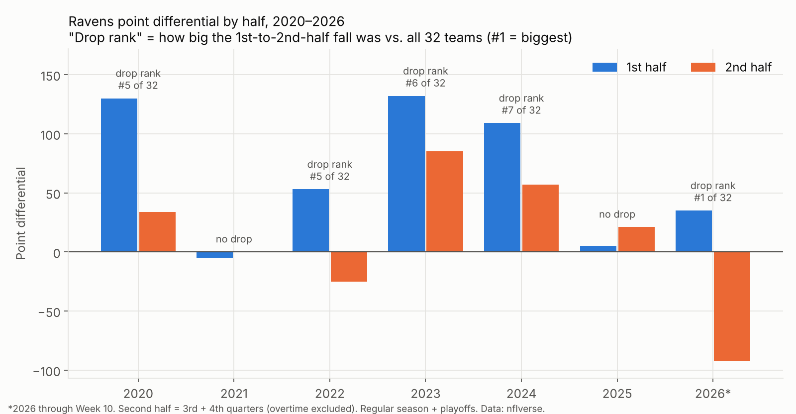
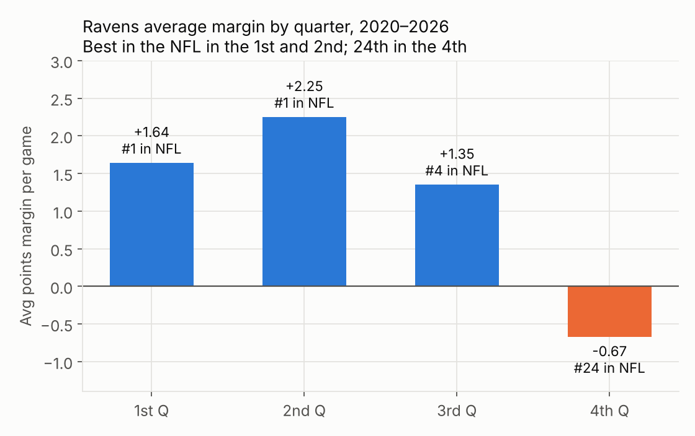
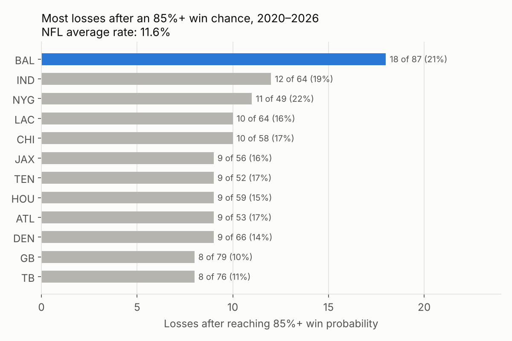
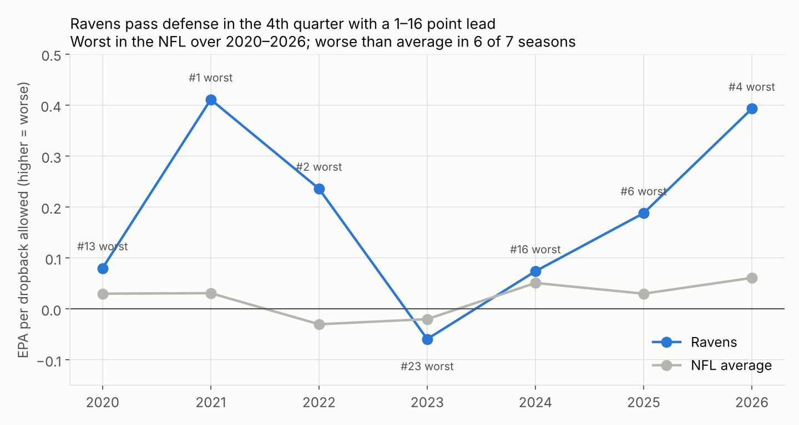

# Why do the Ravens fade in second halves? (2020–2026)

Data: nflverse play-by-play, regular season + playoffs. 2026 is through Week 10.
"Second half" = 3rd + 4th quarters (overtime left out). "Leading" = up 1–16 points.

## 1. How unusual is the fade?

| Season | Coach | 1st half | 2nd half | Drop | Drop rank of 32 | Flag |
|---|---|---|---|---|---|---|
| 2020 | Harbaugh | +130 | +34 | −96 | **5th** | Big drop |
| 2021 | Harbaugh | −5 | 0 | +5 | 16th | — |
| 2022 | Harbaugh | +53 | **−25** | −78 | **5th** | Won 1st half, lost 2nd + big drop |
| 2023 | Harbaugh | +132 | +85 | −47 | **6th** | Big drop |
| 2024 | Harbaugh | +109 | +57 | −52 | **7th** | Big drop |
| 2025 | Harbaugh | +5 | +21 | +16 | 20th | — |
| 2026 | Minter | +35 | **−92** | −127 | **1st** | Won 1st half, lost 2nd + biggest drop in NFL; 2nd half is last in NFL |

- **Over 2020–2026 combined, the Ravens' drop (+459 first halves → +80 second halves, −379) is the biggest in the NFL.**
  League average drop is 0.
- Best comparison: Buffalo had the same first-half margin (+455) and was **+606** in second halves.
- Fair caveat: no team keeps all of its first-half edge. League-wide, teams carry about 35% of
  their first-half margin into the second half. Against that yardstick the Ravens are 74 points
  below expected over the span (11th worst). Most of that shortfall comes from 2022 and 2026; in
  2023–2025 their second halves were about as good as expected. The pattern is real, but it
  isn't every year.

## 2. It's a 4th-quarter problem

Average point margin per game by quarter: Q1 +1.64 (**1st**), Q2 +2.25 (**1st**), Q3 +1.35 (4th), **Q4 −0.67 (24th)**.

## 3. Blown leads

| | Ravens | NFL rate | Ravens rank |
|---|---|---|---|
| Lost after leading by 10+ | **17** of 75 (23%) | 17% | **Most in NFL** (9th by rate) |
| Lost after 85%+ win probability | **18** of 87 (21%) | 12% | **Most in NFL** (3rd by rate) |
| Led at half, lost the game | 19 of 72 (26%) | 23% | 11th |
| Led at half, lost the 2nd half | 31 of 72 (43%) | 49% | 27th (better than average) |

Two things stand out. First, they get big leads more than almost anyone, so the raw count is
inflated. But the *rate* of losing after an 85% win chance is nearly double the league's.
Second, they don't lose the second half more often after leading at the half. When they do lose
it, they lose the whole game.

Full list of flagged games: `game_flags.csv` (filter team = BAL).

## 4. What they do differently when leading

### Defense: the main problem
4th quarter, leading by 1–16, pass plays (`pass_run_by_period.csv`, `q4_pass_defense_by_season.csv`):

- EPA per dropback allowed: **Ravens +0.153 vs NFL +0.013. Worst in the NFL over 2020–2026.**
- Worse than league average in 6 of 7 seasons (all but 2023). That holds across three defensive
  coordinators (Martindale, Macdonald, Orr) and the 2026 staff.
- Same defense in the 1st half with a lead is good: −0.047 EPA per play allowed, better than the NFL's +0.016.

Second half with a lead (`behavior.csv`), Ravens vs NFL, rank of 32:
- EPA allowed per play +0.062 vs +0.001 (**5th worst**)
- 3rd downs allowed 43% vs 40% (**4th worst**); 34% when leading in the 1st half
- Explosive plays allowed 10.2% vs 8.8% (**3rd worst**)
- Takeaways 1.9% of plays vs 2.6% (**28th**)
- Points allowed per opponent drive: 2.52 vs 2.08 (**4th most**). Above league average every season except 2023.

### Offense: the most conservative in the league, but efficient
Second half with a lead:
- Pass rate 42% vs NFL 50% (**32nd: lowest in the NFL**)
- Early-down pass rate 37% vs 43% (30th). Pass rate over expected −6.7% (30th).
- In the 4th quarter specifically: 31.5% pass rate vs the NFL's 44%.
- Pace: 30.8 seconds per snap (4th slowest).

They run a lot and burn clock. On average it still works: success rate is **1st** in the NFL,
EPA per play 3rd, and points per drive 2.39 vs 1.80 (3rd). The conservatism alone doesn't explain
the fades. It does mean fewer possessions, so each defensive breakdown counts for more.

### In the blown games specifically
Second half while leading, blown games vs games where they held on:
- Offense EPA per play −0.07 vs +0.19; 3rd downs 34% vs 51%; turnovers 2.4% vs 0.6% of plays.
- Defense EPA allowed +0.22 vs −0.16; 3rd downs allowed 52% vs 35%; takeaways 0.7% vs 3.5%.

Note: this split is partly circular. A game is "blown" *because* the other team scored, so the
defense will look worse in those games by definition. The league comparisons above are the
stronger evidence.

### Not the cause
- 4th-down decisions: go-for-it rate when leading in the 2nd half is 11% vs NFL 11%. They convert 89% vs the NFL's 60% (small sample: about 18 attempts).
- Penalties: about league average on both sides.
- Sacks: about league average on both sides.

## Bottom line
1. The Ravens are the best 1st-quarter and 2nd-quarter team in the NFL since 2020 and 24th in the 4th quarter.
2. The clearest repeated weakness is **pass defense late in games with a lead**: worst in the league,
   through three defensive coordinators and a new head coach. Opponents throw on 78% of plays (about the same as
   vs. other leading teams), and the Ravens allow more explosive plays and 3rd-down conversions while forcing fewer turnovers. That
   points to a soft, prevent-style approach or a late-game coverage problem, not a pass-rush problem.
3. The offense turns very run-heavy with a lead (lowest pass rate in the NFL). It's efficient on
   average, but it shortens the game and leaves little margin when the defense slips.
4. 2026 is the most extreme season in this span. It's also only 10 games (34 Q4 dropbacks faced
   with a lead), so expect some of it to even out.

## Files
- `halves.py` → `team_games.csv`, `ravens_by_season.csv` (all teams, 1999–2026)
- `fade.py` → `season_fade.csv` (drop ranks, expected 2nd half)
- `blown.py` → `game_flags.csv`, `blown_by_team.csv`
- `behavior.py` → `behavior.csv`, `behavior_ranks.csv`
- `extras.py` → `quarters.csv`, `drives.csv`, `fourth_downs.csv`, `pass_run_by_period.csv`, `q4_pass_defense_by_season.csv`
- `charts.py` → `chart_*.png`

Run order: `halves.py DATA`, `fade.py`, `blown.py DATA`, `behavior.py DATA`, `extras.py DATA`, `charts.py`,
where `DATA` holds `pbp_slim.parquet` (selected columns of nflverse `play_by_play_1999`–`2026.parquet`).
