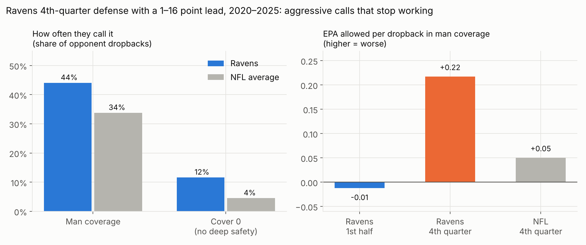
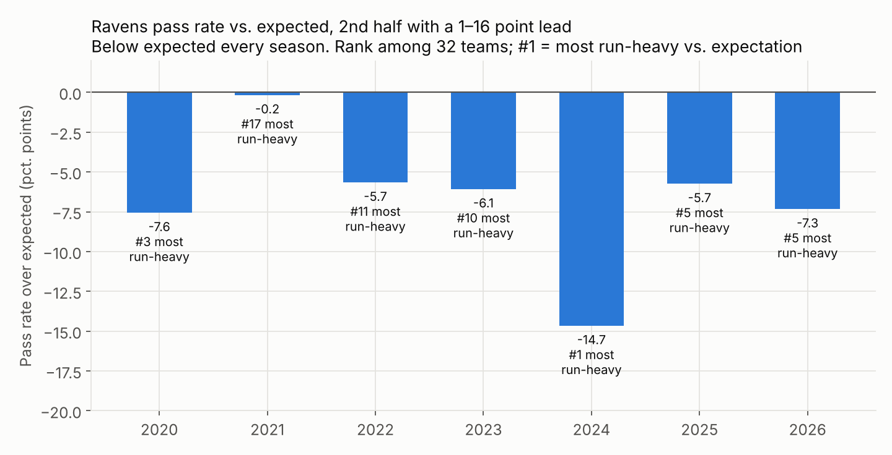

# Why do the Ravens fade in second halves? (2020–2026)

Data: nflverse play-by-play, regular season + playoffs. 2026 is through Week 10.
"Second half" = 3rd + 4th quarters (overtime left out). "Leading" = up 1–16 points.

## 1. How unusual is the fade?

| Season | Coach | 1st half | 2nd half | Drop | Drop rank of 32 | Flag |
|---|---|---|---|---|---|---|
| 2020 | Harbaugh | +130 | +34 | −96 | **5th** | Big drop |
| 2021 | Harbaugh | −5 | 0 | +5 | 16th | — |
| 2022 | Harbaugh | +53 | **−25** | −78 | **5th** | Won 1st half, lost 2nd + big drop |
| 2023 | Harbaugh | +132 | +85 | −47 | **6th** | Big drop |
| 2024 | Harbaugh | +109 | +57 | −52 | **7th** | Big drop |
| 2025 | Harbaugh | +5 | +21 | +16 | 20th | — |
| 2026 | Minter | +35 | **−92** | −127 | **1st** | Won 1st half, lost 2nd + biggest drop in NFL; 2nd half is last in NFL |

- **Over 2020–2026 combined, the Ravens' drop (+459 first halves → +80 second halves, −379) is the biggest in the NFL.**
  League average drop is 0.
- Best comparison: Buffalo had the same first-half margin (+455) and was **+606** in second halves.
- Fair caveat: no team keeps all of its first-half edge. League-wide, teams carry about 35% of
  their first-half margin into the second half. Against that yardstick the Ravens are 74 points
  below expected over the span (11th worst). Most of that shortfall comes from 2022 and 2026; in
  2023–2025 their second halves were about as good as expected. The pattern is real, but it
  isn't every year.

## 2. It's a 4th-quarter problem

Average point margin per game by quarter: Q1 +1.64 (**1st**), Q2 +2.25 (**1st**), Q3 +1.35 (4th), **Q4 −0.67 (24th)**.

## 3. Blown leads

| | Ravens | NFL rate | Ravens rank |
|---|---|---|---|
| Lost after leading by 10+ | **17** of 75 (23%) | 17% | **Most in NFL** (9th by rate) |
| Lost after 85%+ win probability | **18** of 87 (21%) | 12% | **Most in NFL** (3rd by rate) |
| Led at half, lost the game | 19 of 72 (26%) | 23% | 11th |
| Led at half, lost the 2nd half | 31 of 72 (43%) | 49% | 27th (better than average) |

Two things stand out. First, they get big leads more than almost anyone, so the raw count is
inflated. But the *rate* of losing after an 85% win chance is nearly double the league's.
Second, they don't lose the second half more often after leading at the half. When they do lose
it, they lose the whole game.

Full list of flagged games: `game_flags.csv` (filter team = BAL).

## 4. What they do differently when leading

### Defense: the main problem
4th quarter, leading by 1–16, pass plays (`pass_run_by_period.csv`, `q4_pass_defense_by_season.csv`):

- EPA per dropback allowed: **Ravens +0.153 vs NFL +0.013. Worst in the NFL over 2020–2026.**
- Worse than league average in 6 of 7 seasons (all but 2023). That holds across three defensive
  coordinators (Martindale, Macdonald, Orr) and the 2026 staff.
- Same defense in the 1st half with a lead is good: −0.047 EPA per play allowed, better than the NFL's +0.016.

Second half with a lead (`behavior.csv`), Ravens vs NFL, rank of 32:
- EPA allowed per play +0.062 vs +0.001 (**5th worst**)
- 3rd downs allowed 43% vs 40% (**4th worst**); 34% when leading in the 1st half
- Explosive plays allowed 10.2% vs 8.8% (**3rd worst**)
- Takeaways 1.9% of plays vs 2.6% (**28th**)
- Points allowed per opponent drive: 2.52 vs 2.08 (**4th most**). Above league average every season except 2023.

### Offense: the most conservative in the league, but efficient
Second half with a lead:
- Pass rate 42% vs NFL 50% (**32nd: lowest in the NFL**)
- Early-down pass rate 37% vs 43% (30th). Pass rate over expected −6.7% (30th).
- In the 4th quarter specifically: 31.5% pass rate vs the NFL's 44%.
- Pace: 30.8 seconds per snap (4th slowest).

They run a lot and burn clock. On average it still works: success rate is **1st** in the NFL,
EPA per play 3rd, and points per drive 2.39 vs 1.80 (3rd). The conservatism alone doesn't explain
the fades. It does mean fewer possessions, so each defensive breakdown counts for more.

### In the blown games specifically
Second half while leading, blown games vs games where they held on:
- Offense EPA per play −0.07 vs +0.19; 3rd downs 34% vs 51%; turnovers 2.4% vs 0.6% of plays.
- Defense EPA allowed +0.22 vs −0.16; 3rd downs allowed 52% vs 35%; takeaways 0.7% vs 3.5%.

Note: this split is partly circular. A game is "blown" *because* the other team scored, so the
defense will look worse in those games by definition. The league comparisons above are the
stronger evidence.

### Not the cause
- 4th-down decisions: go-for-it rate when leading in the 2nd half is 11% vs NFL 11%. They convert 89% vs the NFL's 60% (small sample: about 18 attempts).
- Penalties: about league average on both sides.
- Sacks: about league average on both sides.

## 5. Deep dive: 4th-quarter pass defense — what are they calling?
Tracking data: nflverse participation (coverage, man/zone, rushers, pressure, time to throw; 2020–2025)
and FTN charting (blitzers; 2022–2026). Opponent dropbacks, Ravens up 1–16 in the 4th quarter (764 plays),
vs. the same defense with a 1st-half lead and vs. the other 31 teams in the 4th with a lead.
Files: `deep_defense*.csv`.

**It is not a soft prevent defense. It's the opposite.**

| 4th quarter, leading | Ravens | NFL | Ravens rank of 32 |
|---|---|---|---|
| Man coverage rate | **44%** | 34% | **2nd most** |
| Cover 0 (all-out man, no deep safety) | **12%** | 4% | Top 3 in 5 of 6 seasons |
| Prevent coverage | 0.4% | 0.6% | about average |
| Rushers sent / blitz rate | 4.3 / 22% | 4.2 / 25% | about average |
| Pressure rate | 30% | 32% | 25th |
| Opponent time to throw | 2.70s | 2.79s | quickest in NFL |
| EPA per dropback allowed | **+0.15** | +0.01 | **worst** |
| 20+ yard completions allowed | **11.3%** | 8.0% | **worst** |
| Completion % over expected allowed | +2.2 | −0.6 | 4th worst |
| Interception rate | 1.6% | 2.7% | 30th |
| Contested-catch rate | 16% | 14% | 6th |

What it shows:
- **The call stays the same, and opponents beat it.** Ravens man coverage allows −0.01 EPA per
  dropback in the 1st half and **+0.22 in the 4th**. The NFL average in man in the 4th is +0.05. Cover 0
  goes from −0.18 (1st half) to +0.32 (4th). Small samples per coverage (50–180 plays each), but the
  direction is the same for every man-based call.
- **Opponents answer it with quick throws.** Against Ravens man coverage in the 4th, the ball comes out in
  2.52 seconds, so the pressure never gets home. The Ravens' pressure rate is 25th. Man coverage with no
  pressure leaves corners alone on quick routes and occasionally deep.
- Zone isn't a fix either: +0.15 EPA in the 4th, still worse than the league.
- **Not fatigue or backups.** Ravens defenders have played about the same number of snaps by the 4th
  quarter as the league (42 vs 44). Their top-11 defenders are on the field as often in the 4th as the
  league norm.
- **Why it survives coordinator changes:** man-heavy, blitz-and-Cover-0 has been the Ravens' defensive
  identity for years, and each coordinator in this span (Martindale, Macdonald, Orr) was promoted from
  inside the Ravens' own staff. Cover 0 in the 4th with a lead was top 3 in the NFL in 2020, 2021, 2023,
  2024 and 2025. The data can't prove why the staff keeps calling it. It does show the same aggressive
  approach carrying into situations where offenses are set up to beat it.

## 6. Deep dive: the run-heavy offense — choice or situation?
Files: `deep_offense*.csv`. Plays the Ravens run while up 1–16.

**It's a choice.** nflverse's expected pass rate model accounts for down, distance, field position,
score and time. In the 4th quarter with a lead the Ravens pass **9.2 points below expected, last in the NFL**.
The league is at +0.7. They are below expected in every season 2020–2026, under both offensive
coordinators in the Harbaugh years and in 2026. 2024 was the extreme: −14.7 in the 2nd half, most
run-heavy in the league.

| 4th quarter, leading | Ravens | NFL | Ravens rank of 32 |
|---|---|---|---|
| Pass rate | 32% | 44% | 32nd (lowest) |
| Pass over expected | −9.2 | +0.7 | 32nd |
| 1st-down pass rate | 21% | 27% | 30th |
| Under center | 27% | 47% | 31st (they stay in the gun and run) |
| 3+ WR personnel | 29% | 49% | 31st |
| QB designed runs (share of runs) | 19% | — | 1st |
| Defenders in the box | 6.9 | 6.7 | most in NFL |
| 8+ man box | 27% | 20% | 4th most |

**But the running works.** Run EPA in the 4th with a lead is +0.02 vs the NFL's −0.09 (**1st**).
Run success 44% vs 36% (1st). Stuffs 15% vs 21%. They gain 5.0 yards a carry even against 8+ man boxes (NFL 3.6).
Because of that, they face shorter 3rd downs (5.6 yards vs 6.8; 3rd-and-7+ only 34% of the time vs 46%).
Their 4th-quarter EPA per play (+0.02) is still above the NFL's (−0.02).

Where it arguably costs them: in 2020, 2024 and 2025 their early-down *passing* in 2nd halves with
a lead was much better than their running (2024: +0.32 vs +0.15; 2025: +0.52 vs +0.01), and they still
passed far less than expected. The offense isn't what's losing these games. It is choosing the
lower-variance option even when passing is working, which keeps the score close and puts the game on
the defense.

## Bottom line
1. The Ravens are the best 1st-quarter and 2nd-quarter team in the NFL since 2020 and 24th in the 4th quarter.
2. The main repeated weakness is **pass defense late in games with a lead**: worst in the NFL, across
   three defensive coordinators and a new head coach.
3. **It's a play-calling identity, not a soft defense.** The Ravens keep calling man coverage and Cover 0
   at 2–3 times the league rate. Opponents trailing late throw quick, the pressure doesn't arrive, and the
   Ravens give up the most 20+ yard completions in the league. The same calls work in the 1st half.
4. **The offense turns the most run-heavy in the NFL with a lead, by choice** (last in pass rate over
   expected). The running itself is the best in the league, so it isn't the cause. But it means fewer
   points added late, and even when passing is working, the game is left on the defense.
5. **Why it hasn't been fixed:** both habits run through every coordinator change, and the defensive
   coordinators all came from the Ravens' own staff. That's the "culture" in measurable form: a
   long-standing, aggressive defensive philosophy and a conservative clock-killing offense that the
   organization keeps choosing.
6. 2026 is the most extreme season in this span. It's also only 10 games (34 Q4 dropbacks faced with a
   lead), so some of it should even out.

## Files
- `halves.py` → `team_games.csv`, `ravens_by_season.csv` (all teams, 1999–2026)
- `fade.py` → `season_fade.csv` (drop ranks, expected 2nd half)
- `blown.py` → `game_flags.csv`, `blown_by_team.csv`
- `behavior.py` → `behavior.csv`, `behavior_ranks.csv`
- `extras.py` → `quarters.csv`, `drives.csv`, `fourth_downs.csv`, `pass_run_by_period.csv`, `q4_pass_defense_by_season.csv`
- `deep_defense.py` → `deep_defense.csv`, `deep_defense_coverage.csv`, `deep_defense_by_season.csv`, `deep_defense_starters.csv`,
  `deep_defense_cover0_by_season.csv`, `deep_defense_man_zone.csv`
- `deep_offense.py` → `deep_offense.csv`, `deep_offense_by_season.csv`, `deep_offense_box.csv`
- `charts.py` → `chart_*.png`

Run order: `halves.py DATA`, `fade.py`, `blown.py DATA`, `behavior.py DATA`, `extras.py DATA`,
`deep_defense.py DATA`, `deep_offense.py DATA`, `charts.py`.
`DATA` holds `pbp_slim.parquet` (selected columns of nflverse `play_by_play_1999`–`2026.parquet`) and
`pbp_deep.parquet` (2020–2026 play-by-play joined on game_id + play_id to nflverse `pbp_participation_2020`–`2025`
and `ftn_charting_2022`–`2026`).
